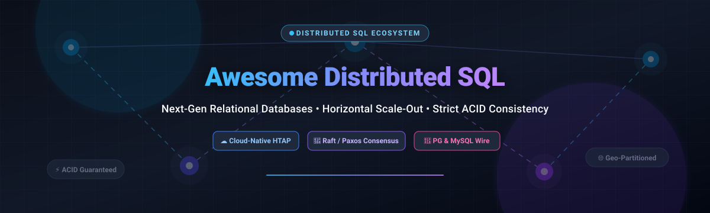

# 🚀 Awesome Distributed SQL Database

  <strong>Curated Directory of Cloud-Native Relational Databases, Sharding Gateways, and NewSQL Engines</strong>

  
  
  
  
  
  

  <em>Comprehensive guide to Horizontal Scalability, ACID Transactions, Consensus Protocols (Raft & Paxos), and Cloud-Native NewSQL Operations.</em>

---

## 📌 Executive Summary & Key Concepts

**Distributed SQL databases** (frequently referred to as **NewSQL**) combine the transactional guarantees and relational capabilities of traditional RDBMS (PostgreSQL, MySQL, SQL Server) with the horizontal scalability and fault-tolerance of NoSQL architectures.

### 🔍 Key Capabilities
- 🔄 **Horizontal Write & Read Scaling**: Scale compute and storage dynamically across nodes, availability zones, and multi-cloud geographic regions.
- 🛡️ **Distributed ACID Guarantees**: Native support for multi-statement, multi-shard transactions with Serializable or Snapshot Isolation without sacrificing correctness.
- 🌐 **Consensus Replication**: Data replicas synchronized using **Raft** or **Paxos** protocols, guaranteeing automatic failover with zero data loss (RPO=0, low RTO).
- 🔌 **Wire Protocol Compatibility**: Full drop-in wire and ecosystem compatibility with **PostgreSQL** or **MySQL** drivers, ORMs, and BI reporting tools.
- ⚡ **Hybrid Transactional/Analytical Processing (HTAP)**: Single engine executing low-latency point queries alongside real-time analytical aggregation.

---

## 📑 Table of Contents

- [📊 Sector Overview & Market Dynamics](#-sector-overview--market-dynamics)
- [☁️ SaaS / Managed Cloud SQL Platforms](#️-saas--managed-cloud-sql-platforms)
- [💻 Open-Source Distributed Database Projects](#-open-source-distributed-database-projects)
- [🤝 How to Contribute](#-how-to-contribute)
- [⚠️ Architecture Trade-Offs & Disclaimer](#️-architecture-trade-offs--disclaimer)
- [💖 Support & Sponsorship](#-support--sponsorship)
- [📈 Star History](#-star-history)

---

## 📊 Sector Overview & Market Dynamics

The global distributed SQL and cloud-native database market is estimated at approximately **$25–30 billion in 2026**, expanding at a compound annual growth rate (**CAGR**) exceeding **20%** driven by multi-cloud resilience requirements, microservice decentralization, and mission-critical transactional volumes.

The sector demonstrates **moderate concentration with a barbell distribution**:
1. **Hyperscalers (Consolidated Core)**: Cloud titans—AWS Aurora, Google Cloud SQL/Spanner, and Azure SQL—capture significant market share for single-cloud enterprises demanding integrated managed operational tiers.
2. **Specialized NewSQL Leaders (High Innovation Moat)**: Independent engines (such as CockroachDB, TiDB, YugabyteDB, and Neon) command the frontier for zero-downtime geo-partitioning, vendor-agnostic deployments, copy-on-write branching, and true distributed horizontal write sharding.

---

## ☁️ SaaS / Managed Cloud SQL Platforms

The table below outlines leading enterprise cloud and SaaS platforms providing managed and distributed SQL engines. Sorted in descending order by company valuation / parent revenue scale.

| 🏢 Company / Platform | 💰 Scale (Valuation / Revenue) | 🏷️ Starting Pricing | 🎁 Free Tier / Free Trial Limits | 📝 Overview & Best For |
| :--- | :--- | :--- | :--- | :--- |
| **[Microsoft Azure SQL](https://azure.microsoft.com/en-us/products/azure-sql/database/)** | Parent Market Cap: ~$3.1T Cloud Revenue: ~$135B+/yr | Starting at ~$0.02/vCore-hour (Serverless) or ~$14.60/month (Basic DTU, 5 DTUs, 2 GB) | **Free for lifetime**: 100,000 vCore-seconds/month (~32 vCore-hours compute), 32 GB storage, 1 database per subscription | Fully managed SQL Server with automated backups, high availability, and AI tuning. Best for enterprise Windows/.NET ecosystems. |
| **[Amazon Aurora](https://aws.amazon.com/rds/aurora/)** | Parent Market Cap: ~$2.1T AWS Revenue: ~$105B+/yr | Aurora Serverless v2 from $0.12/ACU-hour; Standard provisioned `db.t4g.medium` from ~$0.073/hour | **Free trial**: 12-month free tier for new accounts offering up to 4 ACUs with 1 GiB storage, plus $100 AWS credits | High-performance MySQL & PostgreSQL engine with decoupled compute and distributed storage replication. Best for AWS-native workloads. |
| **[Google Cloud SQL](https://cloud.google.com/sql)** | Parent Market Cap: ~$2.0T GCP Revenue: ~$45B+/yr | Starting from ~$0.015/hour (~$11/month for `db-f1-micro`, 1 vCPU, 0.6 GB RAM) + $0.17/GB storage/month | **Free trial**: 30-day free trial on Enterprise Plus configuration (MySQL/PostgreSQL) and $300 new customer credit | Managed MySQL, PostgreSQL, and SQL Server with automated zero-downtime maintenance. Best for teams on Google Cloud Platform. |
| **[CockroachDB Cloud](https://www.cockroachlabs.com/get-started-cockroachdb/)** | Valuation: ~$5.0B Revenue: ~$150M+ ARR | Serverless Basic starts at $0.20 per 1M RUs; Standard dedicated provisioned nodes from $0.22/vCPU-hour | **Free for lifetime**: Basic Serverless tier includes 50M Request Units (RUs) and 10 GiB storage free per month; $400 credits on 30-day trial | True distributed SQL with survivability and geo-partitioning across multi-cloud clusters. Best for global apps needing ACID compliance. |
| **[SingleStore](https://www.singlestore.com/)** | Valuation: ~$1.3B Revenue: ~$100M+ ARR | Shared starter compute workspace starting at $0.99/hour; Standard provisioned tier at $1.49/hour | **Free tier**: 1 permanent free Shared Workspace with limited capacity, plus $600 free credits for Standard evaluation | Distributed SQL database optimized for high-throughput HTAP, combining transactional and real-time analytical queries. |
| **[Supabase](https://supabase.com/)** | Valuation: ~$500M+ Revenue: ~$25M+ ARR | Micro compute starting at $10/month (1 GB RAM, 10 GB storage); Pro tier at $25/month base | **Free for lifetime**: Nano compute with 500 MB database storage, 1 GB file storage, 2 GB egress bandwidth, and 50,000 MAUs | PostgreSQL backend-as-a-service with auto-generated REST/GraphQL APIs, real-time subscriptions, and auth. Best for full-stack apps. |
| **[Neon](https://neon.tech/)** | Valuation: ~$400M Revenue: ~$10M+ ARR | Launch tier starts at $0.106/CU-hour (autoscaling up to 16 CU); storage at $0.35/GB-month | **Free for lifetime**: 100 CU-hours compute/month (~400 hours of 0.25 CU), 1 GB storage per project, across up to 100 projects | Serverless PostgreSQL with instantaneous copy-on-write branching, autoscaling, and scale-to-zero capabilities. Best for preview environments. |
| **[PlanetScale](https://planetscale.com/)** | Valuation: ~$300M+ Revenue: ~$15M+ ARR | Scalable base plan starting at $39/month (includes 10 GB storage, 100M row reads, 10M row writes); storage $0.50/GB-month | **Free trial**: 14-day free trial on Hobby/Pro with database branching and up to 5 GB storage | Vitess-powered horizontally scalable MySQL with non-blocking schema migrations and Git-like database branching. |

---

## 💻 Open-Source Distributed Database Projects

The following active open-source projects power distributed SQL, horizontally scalable relational workloads, and distributed query processing. Sorted in descending order by GitHub stars.

1. **[ClickHouse](https://github.com/ClickHouse/ClickHouse)**   
   🚀 Column-oriented distributed SQL DBMS for real-time analytical reporting (Apache-2.0). Blazing-fast SQL queries over petabytes of distributed data with linear scale-out.

2. **[DuckDB](https://github.com/duckdb/duckdb)**   
   🦆 In-process SQL OLAP database management system (MIT). High-performance analytical query processing with seamless zero-copy integration across Apache Arrow, Parquet, and distributed analytical engines.

3. **[TiDB](https://github.com/pingcap/tidb)**   
   ⚡ Cloud-native, distributed SQL database for modern applications (Apache-2.0). MySQL protocol compatible with horizontal write scalability, strong consistency via Raft, and real-time HTAP engine.

4. **[SurrealDB](https://github.com/surrealdb/surrealdb)**   
   🔮 Multi-model distributed database combining SQL, graph, and document store queries with distributed ACID transactions, real-time live queries, and granular permission access.

5. **[CockroachDB](https://github.com/cockroachdb/cockroach)**   
   🪳 Cloud-native distributed SQL database architected for high availability, zero-downtime rolling upgrades, geo-partitioning, and strongly consistent distributed ACID transactions with PostgreSQL wire compatibility.

6. **[TDengine](https://github.com/taosdata/TDengine)**   
   📈 Open-source distributed time-series database with full SQL support (AGPL-3.0). High-throughput ingestion, data caching, stream processing, and multi-node clustering for IoT and industrial big data.

7. **[Neon](https://github.com/neondatabase/neon)**   
   🟢 Serverless open-source alternative to AWS Aurora Postgres (Apache-2.0). Decouples compute and storage, offering instant database branching, scale-to-zero, and petabyte-scale cloud-native storage.

8. **[Vitess](https://github.com/vitessio/vitess)**   
   🌐 Database clustering system for horizontal scaling of MySQL (Apache-2.0). Battle-tested at YouTube, Slack, and GitHub; encapsulates shard routing, dynamic resharding, connection pooling, and failover.

9. **[Apache ShardingSphere](https://github.com/apache/shardingsphere)**   
   🔮 Distributed SQL ecosystem providing a transparent database gateway (Apache-2.0). Adds distributed transactions, horizontal sharding, read/write splitting, and data encryption to any standard relational database.

10. **[rqlite](https://github.com/rqlite/rqlite)**   
    💡 Lightweight, distributed relational database built on SQLite and the Raft consensus protocol (MIT). Provides effortless clustering, replication, and fault tolerance with an easy HTTP/SQL interface.

11. **[QuestDB](https://github.com/questdb/questdb)**   
    ⏱️ High-performance, open-source distributed SQL time-series database (Apache-2.0). Column-oriented architecture with SIMD vectorization, InfluxDB Line Protocol ingestion, and PostgreSQL wire compatibility.

12. **[Apache Doris](https://github.com/apache/doris)**   
    🐬 High-performance, real-time distributed analytical database (Apache-2.0). Supports high-concurrency point queries, sub-second reporting, and interactive analysis with standard MySQL protocol compatibility.

13. **[Citus](https://github.com/citusdata/citus)**   
    🐘 PostgreSQL extension that transforms Postgres into a distributed database (AGPL-3.0). Horizontally shards tables across multiple nodes with distributed queries, reference tables, and columnar storage.

14. **[StarRocks](https://github.com/StarRocks/starrocks)**   
    ⭐ Next-generation sub-second distributed OLAP database (Apache-2.0). Features a vectorized execution engine, cost-based optimizer, real-time materialized views, and unified query acceleration over data lakes.

15. **[YugabyteDB](https://github.com/yugabyte/yugabyte-db)**   
    🪐 High-performance distributed SQL database for mission-critical apps (Apache-2.0 core). Combines complete PostgreSQL runtime and wire compatibility with Google Spanner-inspired distributed Raft consensus and auto-sharding.

16. **[OceanBase](https://github.com/oceanbase/oceanbase)**   
    🌊 Enterprise-grade distributed relational database designed for ultra-high transaction concurrency and multi-cloud resilience (MulanPubL-2.0). Native multi-tenancy, Paxos-based high availability, and HTAP capabilities.

17. **[Apache Ignite](https://github.com/apache/ignite)**   
    🔥 Distributed database, caching, and in-memory data grid platform (Apache-2.0). Delivers distributed ACID transactions, ANSI-99 SQL support, machine learning APIs, and real-time processing capabilities.

---

## 🤝 How to Contribute

Contributions make the open-source and data community thrive! Feel free to add new distributed SQL engines or update existing information:

1. 🍴 Fork this repository.
2. 🌿 Create your feature branch: `git checkout -b feature/new-database`
3. 📝 Add your entry to `README.md` following the existing format (include link, license, description, and pricing/star badge).
4. 🚀 Commit your changes: `git commit -m "Add NewDistributedDatabase"`
5. 📤 Push to the branch: `git push origin feature/new-database`
6. 🎯 Open a Pull Request with a clear description of the project.

---

## ⚠️ Architecture Trade-Offs & Disclaimer

- 📌 **Managed Cloud SQL vs. True Distributed SQL**: Amazon Aurora, Google Cloud SQL, and Azure SQL Database decouple storage or provide read replicas, but write workloads funnel through a primary node. In contrast, TiDB, CockroachDB, and YugabyteDB are true NewSQL engines that shard writes across nodes using Raft/Paxos consensus.
- 🔌 **Wire Compatibility & Migration Friction**: TiDB provides low-friction drop-in MySQL compatibility. CockroachDB, YugabyteDB, and Citus offer PostgreSQL compatibility. Check your ORMs, stored procedure dependencies, and query patterns prior to migration.
- 📜 **Licensing Considerations**: Several engines use dual licenses or non-standard source licenses for commercial enterprise tooling (e.g. CockroachDB Software License). Verify compliance with your legal and organizational standards.
- 🛡️ **Operational Complexity**: Self-hosting distributed databases requires deep DBA expertise around consensus quorum, multi-AZ networking latency, backup strategies, and rolling updates.

---

## 💖 Support & Sponsorship

If you find this curated ecosystem list helpful for your database engineering, architecture decisions, or research, please consider showing your support:

- ⭐ **Star this repository** to help others discover it!
- 🍴 **Fork and contribute** updates or additional engines.
- 📢 **Share with your team** and on social networks.
- ☕ **Sponsor or buy a coffee**: Support ongoing maintenance via the [GitHub Sponsors Dashboard](https://github.com/sponsors/ishandutta2007).

---

## 📈 Star History

---

  Maintained with ❤️ by Ishan Dutta and the distributed systems open-source community.

